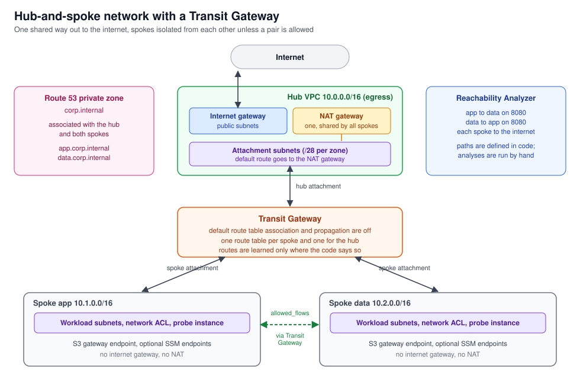

# AWS Hub-and-Spoke Network with Terraform

[](https://github.com/dineshravichandiran/aws-hub-spoke-network-terraform/actions/workflows/terraform.yml)
[](LICENSE)

A multi-VPC network built on an AWS Transit Gateway, written as Terraform modules. One hub VPC
holds the internet gateway and a shared NAT gateway. Two spoke VPCs (`app` and `data`) have no way
out except through the hub, and cannot reach each other unless the code says they may. A private
DNS zone resolves the same names from every VPC, and Reachability Analyzer paths are defined in
code so the answer to "can A reach B?" comes from AWS, not from guessing.

It is the networking companion to [`aws-sre-platform-terraform`](https://github.com/dineshravichandiran/aws-sre-platform-terraform),
which covers the platform, the pipeline and the SLOs.

> **Status: applied once to a real AWS account (2026-11-20), drilled, and destroyed.**
> The first real run found three problems that the offline checks could not see (ping blocked by the network
> ACL, spokes that were not isolated because traffic hairpinned through the hub NAT, and a destroy that failed on
> Analyzer paths that still had analyses). The first two are fixed in code and re-verified live; the third is a
> runbook step. The full log is in [`docs/evidence/real-apply-2026-11-20.txt`](docs/evidence/real-apply-2026-11-20.txt).
> [`docs/RUNBOOK.md`](docs/RUNBOOK.md) is the procedure. Steps 5 and 6 of it were not run.

## What has been checked

| Check | Result | How |
|---|---|---|
| `terraform fmt` and `terraform validate` | pass, 6 modules and the lab | CI, every push |
| Unit and wiring tests | 24 tests pass | `terraform test` against a **mocked** AWS provider (no account, no cost) |
| Security scan | 327 checks pass, 0 fail, 13 skipped with a written reason each | checkov, every push |
| Lint | tflint with the Terraform and AWS rule sets | CI, every push |
| `terraform apply` on a real account | done 2026-11-20: 125 resources in about 4 minutes | CloudShell, local state |
| Reachability Analyzer: app to data, data to app, each spoke to the internet | done: all four reachable | `scripts/drill.sh analyze` |
| Real requests from the probes: private DNS, spoke to spoke, internet through one NAT address | done; ping failed first (network ACL), fixed and re-run | SSM Run Command, `scripts/drill.sh prove` |
| Isolation drill (spokes cut off from each other) | done after a fix: the first attempt showed the spokes still reachable through the hub NAT | analyzer: `TGW_RTB_NO_ROUTE_TO_TGW_ATTACHMENT`; curl timed out |
| `terraform destroy` and a clean bill | done: the first destroy failed on Analyzer paths that still had analyses; after deleting them it destroyed 102 resources and a region sweep was empty | region sweep, see evidence |
| Network ACL deny drill, flow log REJECT line | not done | runbook steps 5 and 6 |

The mocked tests prove the routing logic and the wiring: which route tables exist, which
attachment learns which route, that spokes have no NAT or internet gateway. They do not prove that
AWS accepts every setting or that packets really flow. Only a real apply and the analyzer prove
that.

## Architecture



| Layer | What is built | Module |
|---|---|---|
| Hub and spokes | VPCs with a dedicated /28 attachment subnet per zone, workload subnets, a network ACL on the workload subnets, flow logs. The hub also gets an internet gateway and NAT | [`hub-spoke-vpc`](modules/hub-spoke-vpc) |
| Core | The Transit Gateway, with default association and propagation switched off | [`transit-gateway`](modules/transit-gateway) |
| Segmentation | One route table per spoke and one for the hub, and the rules for who learns whose routes | [`tgw-routing`](modules/tgw-routing) |
| Private AWS access | Free S3 gateway endpoint, optional Systems Manager interface endpoints | [`vpc-endpoints`](modules/vpc-endpoints) |
| Names | One private Route53 zone, `corp.internal`, shared by all VPCs | [`private-dns`](modules/private-dns) |
| Test workload | A tiny instance per spoke: no SSH, no public IP, Session Manager only | [`probe-instance`](modules/probe-instance) |
| Lab | Wires it together and defines the Reachability Analyzer paths | [`envs/lab`](envs/lab) |

## How traffic moves

**A spoke reaches the internet.** The workload route table sends everything not local to the
Transit Gateway. The spoke's Transit Gateway route table has a default route to the hub
attachment. In the hub, the attachment subnet's default route goes to the NAT gateway, then out the
internet gateway. The way back works only because the hub's public route table sends the
`10.0.0.0/8` range to the Transit Gateway and the hub's Transit Gateway table has learned both
spokes.

**App reaches data.** App's Transit Gateway table has learned data's range from a propagation, and
that route is more specific than the default, so the packet goes to the data attachment, not the hub.

**Isolation.** The only reason app can reach data is the pair `["app", "data"]` in
`allowed_flows`. Set it to `[]` and neither spoke learns the other's range. A packet for the other
spoke then matches the **blackhole route for the private supernet** (`10.0.0.0/8`) in the spoke's own
table and is dropped. Longest-prefix match keeps the hub's /16 and an allowed spoke's /16 working.

> The blackhole was added after the first real isolation drill. Without it, the packet followed the default
> route to the hub, the hub NAT gateway sent it back to the Transit Gateway through the hub's private-range
> return route, and the other spoke answered, even though neither spoke had learned the other's range. The
> earlier text here said such a packet "goes nowhere"; that was a guess and it was wrong. Confirmed after
> the fix by the analyzer (`reachable: false`) and by a request that timed out.

| Transit Gateway route table | Attachment | Routes |
|---|---|---|
| `hub` | hub | learns `app` and `data` (propagation) |
| `spoke-app` | app | `0.0.0.0/0` to the hub, hub range (propagation), `data` range **only if allowed** |
| `spoke-data` | data | `0.0.0.0/0` to the hub, hub range (propagation), `app` range **only if allowed** |

**Names.** The private zone is associated with all three VPCs, so `app.corp.internal` and
`data.corp.internal` resolve everywhere. Resolving a name does not make it reachable: the Transit
Gateway routes still decide that.

## Design decisions and the trade-offs I accepted

| Decision | Why | Cost of the choice |
|---|---|---|
| Transit Gateway, not VPC peering | Peering needs a connection per pair and does not route through a third VPC. A Transit Gateway scales to many VPCs and allows central egress | An hourly fee per attachment plus a per-GB charge |
| Default route tables switched off | A Transit Gateway quietly connects everything to everything by default. Here nothing joins a table unless the code says so | More code to write |
| One route table per spoke | Lets one spoke learn another and not a third. Segmentation by route table | More tables to read |
| Central egress through one shared NAT | One place to control and pay for outbound traffic | One zone failing can cut outbound traffic. `single_nat_gateway = false` gives one per zone |
| Dedicated /28 attachment subnets | Keeps attachment network interfaces out of workload subnets, so a network ACL or route change for workloads cannot break the attachment | A few more subnets |
| Network ACL and security groups | The ACL is a stateless backstop on the subnet. Security groups are the tight, stateful rules | The ACL must allow return traffic on high ports explicitly |
| Interface endpoints off by default | Each one costs money per zone per hour | Systems Manager reaches AWS over the NAT path unless they are turned on |
| Local state | A lab that is applied and destroyed in one sitting does not need a remote backend | Not how a team would run it. The remote-state pipeline is in the sibling repository |

## Cost and teardown

This lab costs money while it runs. The Transit Gateway attachments (three) and the NAT gateway
are the biggest items. Rough size, **an estimate and not a quote**: on the order of US$0.25 to 0.40
per hour, more with the interface endpoints on, plus a few cents for each Reachability Analyzer
analysis. Check the AWS pricing pages for `ap-south-1` first, and destroy the same day.

Everything is tagged `Project`, `Environment`, `Owner` and `ManagedBy` through `default_tags`.

## Repository layout

```
modules/hub-spoke-vpc/   a VPC that can be the hub (internet and NAT) or a spoke (no internet)
modules/transit-gateway/ the Transit Gateway
modules/tgw-routing/     route tables, associations, propagations, allowed flows
modules/vpc-endpoints/   S3 gateway endpoint and optional interface endpoints
modules/private-dns/     private Route53 zone shared by all VPCs
modules/probe-instance/  test instance served through Session Manager
envs/lab/                the lab: wires the modules and defines the analyzer paths
docs/                    architecture diagram, runbook, interview notes, evidence
```

## Run the checks yourself

No AWS account is needed.

```bash
make all        # fmt, validate, tests, security scan
```

You need Terraform 1.10 or newer and `checkov` (`pip install checkov`).

## What I would do next

- Run the two drills that were skipped (network ACL deny rule found with the analyzer, flow log REJECT line).
- Pin the probe AMI: the "latest" SSM parameter makes a later plan want to replace the probe instances.
- A firewall in the hub (Network Firewall or a gateway load balancer) with appliance mode on the
  hub attachment, so spoke-to-spoke and egress traffic is inspected.
- A Route 53 Resolver for names shared with an on-premises network.
- A VPN or Direct Connect attachment and a separate route table for it.
- Customer-managed KMS keys for the flow logs, and Transit Gateway flow logs.
- Overlapping CIDR handling (private NAT) for a spoke that cannot be renumbered.

## License

[MIT](LICENSE)
